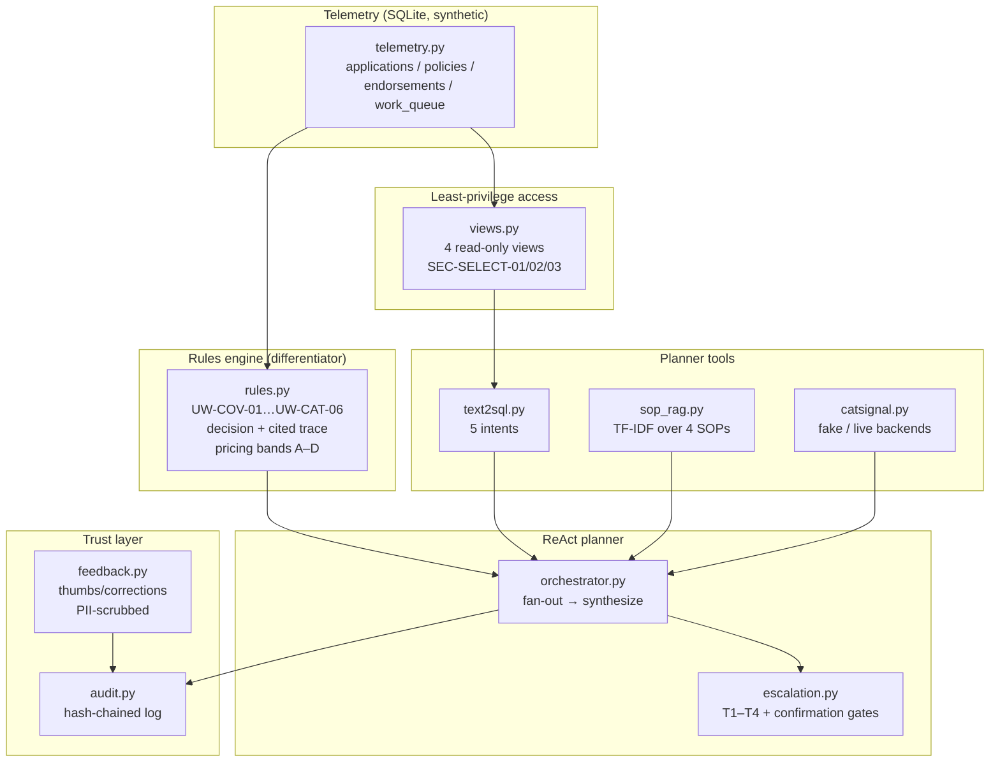

# Architecture

## Flow

1. `telemetry.seed_demo_data` builds the synthetic book (seeded).
2. `views.install_views` exposes 4 read-only views behind the SEC-* gateway.
3. `PlannerAgent.ask` detects intents (fan-out), optionally runs
   `rules.evaluate` on a named application, consults SOP RAG and the cat
   signal, assesses the T1–T4 tier, and mints confirmation gates for
   declines and high-value issuance.
4. Every step lands in the hash-chained `AuditLog`; user feedback is
   PII-scrubbed before it is recorded.
